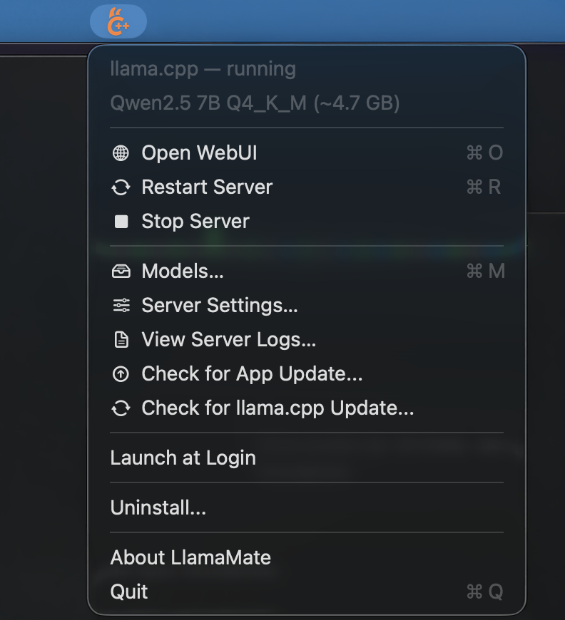
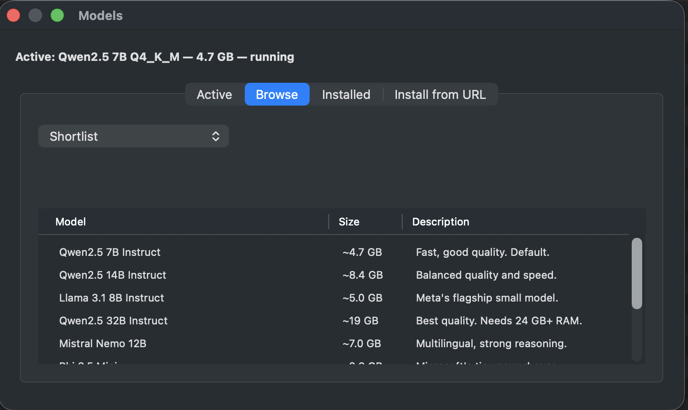
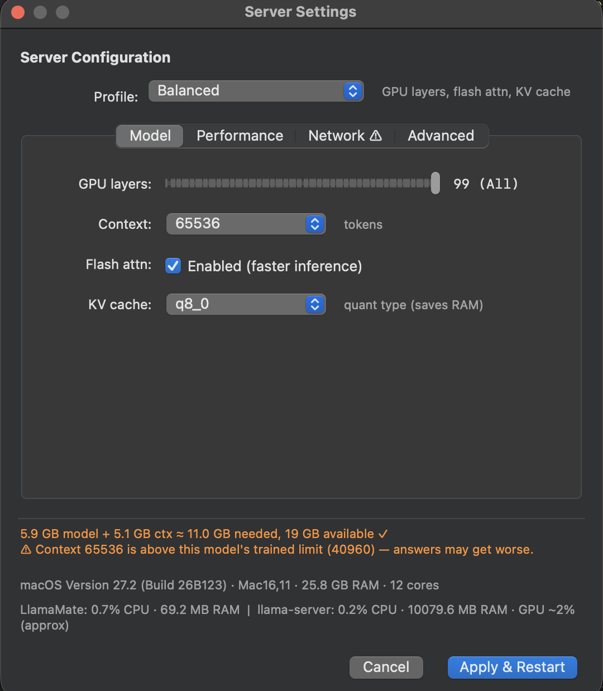

# LlamaMate — llama.cpp for macOS

A menu bar app that installs, runs, updates and tunes [llama.cpp](https://github.com/ggml-org/llama.cpp) on macOS (Apple Silicon & Intel). Install it, click **Install**, and you have a local, OpenAI-compatible LLM server with a chat WebUI — no terminal needed.

## Screenshots

| Menu bar | Models window |
|----------|---------------|
|  |  |

| Server Settings |
|-----------------|
|  |

### Why this exists

llama.cpp releases ship as bare tarballs — no installer, no PATH setup, no Gatekeeper handling, no auto-start, no easy update path. Every new build meant the same manual ritual: download, extract, copy files, fix macOS security warnings, update the shell RC, restart the server. **LlamaMate** wraps all of it into one `.app`.

## Features

- **One-click install** — downloads the latest llama.cpp build for your Mac and a starter model, sets up auto-start and launches the server.
- **Menu bar control** — start / stop / restart, with a status icon that shows *running*, *loading model* and *stopped*, and tells you when another app is using the port.
- **Models** — curated shortlist, Hugging Face search, or paste a URL. Downloads **resume** after a cancel or quit, are **size-checked**, check free disk space first, and handle **split** (`-00001-of-0000N`) and sub-folder GGUF files.
- **Server Settings in tabs** — Model, Performance, Network and Advanced; presets for Apple Silicon and Intel; an accurate **RAM estimate** read from the model's GGUF header.
- **Faster by default** — full GPU offload, flash attention, quantized KV cache, prompt-cache reuse, and **MTP** speculative decoding switched on automatically for models that support it.
- **Reasoning controls** — reasoning effort (Low / Medium / High) and a thinking-token limit.
- **Private by default** — the server listens on this Mac only; LAN access and an **API key** are one click away. Your Hugging Face token is kept in the macOS **Keychain**.
- **Your settings survive updates** — extra flags and custom settings live in a file LlamaMate never overwrites.
- **Updates** — check for new LlamaMate and llama.cpp versions from the menu; Homebrew cask available.
- **Clean uninstall** — from the menu or with `brew uninstall --zap`.

## Install

**Homebrew (recommended):**
```bash
brew tap Ito-69/llamamate
brew install --cask llamamate
```

**DMG:**
1. Download `LlamaMate-<version>.dmg` from [GitHub Releases](https://github.com/Ito-69/llama.cpp_install_on_macos/releases).
2. Open it and drag `LlamaMate.app` to **Applications**.

Then open **LlamaMate** and click **Install** in the welcome dialog. It downloads llama.cpp and a model, sets up the background service and starts the server. No account is needed — see [Hugging Face token](#hugging-face-token) for when one helps.

> [!NOTE]
> ### First launch & Gatekeeper
> LlamaMate is open source and ad-hoc signed (no paid Apple Developer certificate), so macOS may block the first launch:
>
> - Open **System Settings → Privacy & Security**, scroll to **Security**, and click **Open Anyway**.
>   (On macOS 13–14 you can also right-click the app → **Open**. From macOS 15 that shortcut no longer works.)
> - **"LlamaMate is damaged"?** It isn't — that's the quarantine flag browsers add to downloads. Run this once in Terminal, then open the app normally:
>   ```bash
>   xattr -dr com.apple.quarantine /Applications/LlamaMate.app
>   ```

## Use

| URL | What it is |
|-----|------------|
| `http://127.0.0.1:8080` | WebUI — chat in the browser (PDF/image attachments, multiple conversations, JSON output) |
| `http://127.0.0.1:8080/v1` | OpenAI-compatible API (for Open WebUI, VS Code extensions, coding agents, scripts) |
| `http://127.0.0.1:8080/health` | Health check (always open, even with an API key) |

Quick test:

```bash
curl http://127.0.0.1:8080/v1/chat/completions \
  -H "Content-Type: application/json" \
  -d '{"model": "llama", "messages": [{"role": "user", "content": "Hello!"}]}'
```

With an API key set (see [Network & security](#network--security)), add `-H "Authorization: Bearer <your-key>"`.

## Menu bar

The llama icon shows the server state: **full** = running, **half-faded** = loading the model, **faded** = stopped. A small red dot means an update is available.

| Menu item | What it does |
|-----------|--------------|
| *Status line* | `running`, `loading model…`, `stopped`, or `Port N is used by another app` |
| *Active model* | The model the server uses |
| **Open WebUI** (⌘O) | Opens the chat page in your browser |
| **Start / Stop / Restart Server** (⌘S / ⌘R) | Controls the background service. Start recreates the service if an update removed it, and shows an error instead of failing silently. |
| **Models…** (⌘M) | Browse, download, activate and delete models |
| **Server Settings…** | All server options (see below) |
| **View Server Logs…** | Live view of the server log (last 256 KB) |
| **Check for App Update…** | Looks for a newer LlamaMate release (shows the `brew` command for Homebrew installs) |
| **Check for llama.cpp Update…** | Looks for a newer llama.cpp build and offers **Install Update** |
| **Launch at Login** | Starts the menu bar app when you log in (the server itself always auto-starts) |
| **Uninstall…** | See [Uninstall](#uninstall) |
| **About LlamaMate** / **Quit** (⌘Q) | |

## Models

**Models…** opens a window with four tabs:

- **Active** — the current model, its size and server state.
- **Browse** — a curated **Shortlist**, or **Search** Hugging Face (sorted by downloads). The shortlist shows each model's download size and the **Mac RAM** it needs (orange when it's more than your Mac has); hover a row for the full description. Picking a repo opens a file picker with every quantization and its size; split models appear as one entry with their total size.
- **Installed** — every model in `~/models/` (✓ = active). **Make Active** switches and restarts the server; **Delete…** removes the file (all parts of a split model).
- **Install from URL** — paste `owner/repo`, `https://huggingface.co/owner/repo`, or a direct `…/resolve/main/<file>.gguf` link.

**Community models** — tick **Show community models (uncensored / fine-tunes)** to add verified models from independent authors (abliterated/uncensored versions and merges, several with MTP). It's off by default and explained the first time you turn it on: these models are not made by the original model makers, and uncensored ones answer requests the original would refuse — check each model card.

The shortlist comes from [`catalog/models.json`](catalog/models.json) in this repository, so it can be updated without a new app version (the app checks for a newer list every few hours and keeps a built-in copy for offline use). Every entry is checked against Hugging Face by CI — the repo is public, the ~4-bit file exists and its size is right, and models listed with MTP really include the MTP heads — on each change and weekly.

Downloads go to `~/models/` and can be cancelled and resumed — even after quitting the app. A file is only saved once its size matches Hugging Face's, and a download won't start without enough free disk space.

### Hugging Face token

You don't need one for public models — including the default one and most GGUF repos (bartowski, unsloth, ggml-org…). A free [token](https://huggingface.co/settings/tokens) (Read access) helps in two cases:

- **Gated models** (for example official Llama or Gemma repos) — you also accept the licence on the model's page.
- **Download limits** — Hugging Face limits requests from networks without a login.

LlamaMate doesn't ask for it up front. When Hugging Face says a login, a licence or a higher limit is needed, it explains what happened and offers **Add Token…** / **Open Model Page**. Anytime, use **Hugging Face: Set Token…** at the top right of the Models window: paste, **Test** (shows the account name), **Save** or **Remove Token**. The token is stored in your macOS Keychain.

Already logged in with the Hugging Face CLI (`hf auth login`)? LlamaMate uses that token automatically (`~/.cache/huggingface/token`, or `HF_HOME` / `HF_TOKEN_PATH`) unless you save a different one.

## Server Settings

**Server Settings…** has a **Profile** preset at the top, four tabs, and a live RAM estimate plus **Apply & Restart** at the bottom. Apply only restarts the server when something actually changed, so the prompt cache is kept.

### Profiles

| Profile | Apple Silicon | Intel |
|---------|---------------|-------|
| **Fast** | all layers on GPU (`-ngl 99`), flash attention, `q8_0` KV cache | `-ngl 1`, `f16` KV cache |
| **Balanced** *(default)* | all layers on GPU, flash attention, `q8_0` KV cache | CPU only, `f16` KV cache |
| **Accurate** | all layers on GPU, no flash attention, `f16` KV cache | CPU only, `f16` KV cache |

On Apple Silicon the profiles also set Threads to the number of performance cores.

### Model tab

| Setting | What it does |
|---------|--------------|
| **GPU layers** | Layers offloaded to the GPU (0–99). On Apple Silicon keep **99**: Metal is the biggest speed-up. |
| **Context** | Context size in tokens (2,048–262,144, or **Custom…**). More context needs more memory. The window warns when you go above the length the model was trained for. |
| **Flash attn** | Faster attention. Required for a quantized KV cache — turning it off switches the cache to `f16` automatically. |
| **KV cache** | `f16`, `q8_0` (half the memory) or `q4_0` (a quarter). |

### Performance tab

| Setting | What it does |
|---------|--------------|
| **Threads** | CPU threads for generation. **0 = auto**: llama.cpp picks the performance cores. |
| **Batch** | Tokens per batch (2048 recommended on Apple Silicon). |
| **Batch threads** | Threads for prompt processing (`-tb`); empty = auto. |
| **Faster regenerate / chat** | Reuses the prompt cache between requests (`--cache-reuse 256`). On by default. |
| **Keep model in RAM** | Locks the model in memory (mlock). Only if you have free RAM for the whole model. |
| **Parallel** | Requests handled at once: **1** (default), **Auto** (llama.cpp decides, usually 4), 2 or 4. **1** is fastest for one user and uses the least memory, especially with MTP; extra requests wait their turn. Choose more if several apps or people use the server (Open WebUI, for example, sends title requests in parallel). With 2+, every request still gets the full context. |
| **MTP** | Multi-token prediction. LlamaMate reads the model's GGUF header; when the model ships MTP heads it turns on speculative decoding (`--spec-type draft-mtp`, 4 draft tokens, adjustable 2–6). Often about **2× faster** generation with identical output. The row shows **✓ model has MTP** or **no MTP heads**. |

### Network tab

| Setting | What it does |
|---------|--------------|
| **Port** | HTTP port (default 8080). |
| **Allow access from local network** | Off: only this Mac can connect (`127.0.0.1`). On: other devices on your network can (`0.0.0.0`). |
| **API key** | **Generate** creates a random key; clients then send `Authorization: Bearer <key>`. Strongly recommended with LAN access — the tab shows **Network ⚠︎** while LAN is on without a key. |

### Advanced tab

| Setting | What it does |
|---------|--------------|
| **Reasoning** | Reasoning effort: Default / Low / Medium / High (`--reasoning-effort`). Only models trained with effort levels use it (for example gpt-oss). |
| **Thinking limit** | Max tokens a thinking model (Qwen3, DeepSeek-R1, …) may spend reasoning before it answers (`--reasoning-budget`): Unlimited, Off, or 512–8192. |
| **Extra flags** | Any additional llama-server flags, appended last (for example `-np 1`). Kept across updates. An unknown flag stops the server — check **View Server Logs…**. |

New options are only passed to llama-server when the installed llama.cpp build supports them, so an older build keeps working; update llama.cpp from the menu to get them.

### RAM estimate

The bottom of the window shows *model + KV cache ≈ needed* versus the memory macOS lets the GPU use (Metal's working-set limit, about 70–75% of RAM). The KV cache is calculated from the model's GGUF header — layers, KV heads, head size, context and cache type — and for hybrid models (Qwen3.5 / Qwen3-Next, Mamba-style layers) only layers that actually keep a cache are counted. Sliding-window models are marked *(approx.)*.

### Your own settings

LlamaMate manages `~/.config/llama/server.conf` and `~/.local/bin/llama-server-start.sh` and may rewrite them on updates. Your own settings belong in **`~/.config/llama/server.local.conf`** — created once with comments, never overwritten. The **Extra flags** field edits its `EXTRA_ARGS` line; you can also edit the file directly:

```bash
# Extra llama-server flags, appended last (space-separated; values with spaces aren't supported)
EXTRA_ARGS="-np 1 --spec-type draft-mtp --spec-draft-n-max 4"

# Or llama.cpp's environment variables, for flags LlamaMate doesn't pass itself
export LLAMA_ARG_N_PARALLEL=1
```

Restart the server after editing. Also kept across updates:
- any `KEY=…` line you added to `server.conf`;
- a hand-edited start script — before replacing it, LlamaMate saves it as `llama-server-start.sh.user-<date>` and tells you where.

## Network & security

- The server listens on **`127.0.0.1`** by default (existing installs that used `0.0.0.0` keep their setting).
- Turn on **Allow access from local network** to use it from other devices, and set an **API key**. The key is passed with `--api-key-file`, so it doesn't show up in the process list.
- `/health` stays open without a key so the app can show the server state.
- `server.conf` and the key file are readable only by your user (`0600`); every value is quoted and validated before the start script uses it.
- Your Hugging Face token is in the Keychain, not in a plain-text preferences file. It's sent only to huggingface.co.

## Updating

**Homebrew:**
```bash
brew update && brew upgrade --cask llamamate
```
Homebrew removes the background service while upgrading. LlamaMate recreates it on the next launch — if the menu says *stopped*, click **Start Server**.

**DMG:** **Check for App Update…** opens the download page.

**llama.cpp itself:** **Check for llama.cpp Update…** → **Install Update**. Your model and settings stay as they are.

## Uninstall

**From the app — Uninstall…**
- **Remove Everything** — stops the server and removes the background service, llama.cpp binaries and libraries, configuration, app data, the shell RC lines, and the downloaded `.gguf` models (other files in `~/models` are left alone).
- **Keep Models** — the same, but keeps `~/models`.

If LlamaMate was installed with Homebrew, the app doesn't delete itself; it shows the `brew uninstall` command to finish.

**With Homebrew:**
```bash
brew uninstall --cask llamamate          # quits the app, stops the server, removes the app
brew uninstall --zap --cask llamamate    # also removes settings, logs and preferences
```
Homebrew never deletes your models (`~/models`) or the llama.cpp binaries in `~/.local` — use the in-app **Uninstall…** for those.

## Files & directories

| Path | Purpose |
|------|---------|
| `~/.local/bin/` | llama.cpp binaries (`llama-server`, …) and `llama-server-start.sh` |
| `~/.local/lib/` | llama.cpp libraries (`libllama*.dylib`, `libggml*.dylib`) |
| `~/models/` | GGUF models |
| `~/.config/llama/server.conf` | Server settings (managed by LlamaMate) |
| `~/.config/llama/server.local.conf` | Your own settings / extra flags — never overwritten |
| `~/.config/llama/api_key` | API key file (only while a key is set) |
| `~/Library/Application Support/LlamaMate/` | Bundled installer and start script |
| `~/Library/LaunchAgents/com.llama.cpp.server.plist` | Background service (starts the server at login) |
| `~/Library/Logs/llama-server.log`, `llama-server.err.log` | Server logs (rotated above 20 MB) |

## Build from source

```bash
cd llamamate
./build.sh                      # universal .app (arm64 + x86_64), ad-hoc signed
open LlamaMate.app
```

Requires Xcode command-line tools and macOS 13+.

For maintainers:
- Every pull request is built on a macOS runner (`.github/workflows/build.yml`), including the GGUF parser tests in `llamamate/Tests/gguf`.
- Releases: bump `VERSION` in `llamamate/build.sh`, add `release-notes/v<version>.md`, merge, then **Actions → Build Release → Run workflow** with **publish** checked. It builds and verifies the DMG, publishes the GitHub release and updates the Homebrew tap. See `AGENTS.md`.

## Requirements

- macOS 13 Ventura or newer
- Apple Silicon recommended (Metal GPU acceleration); Intel Macs run on the CPU
- An internet connection for the first install and model downloads

No Python or other dependencies — works on a clean Mac.

## License

MIT — feel free to use, modify and share.

---

*Built on [llama.cpp](https://github.com/ggml-org/llama.cpp) by Georgi Gerganov and contributors.*
